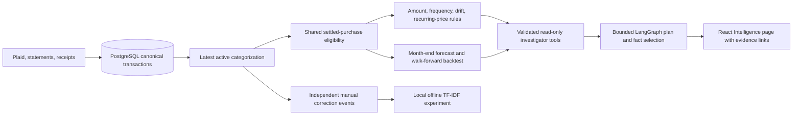

# Financial intelligence architecture

The application stays a modular monolith. Decimal calculations and category/account/currency filters live in backend services. The LLM chooses approved tools and fact IDs; it does not calculate financial totals. The served detectors and forecasts are statistical baselines. Isolation Forest and TF-IDF logistic regression are offline experiments. No feature store, vector database, distributed worker, or model inference service is required.

The serving path uses current canonical transactions and current active categorizations. It cannot exactly reconstruct historical ingestion availability, prior category revisions, or past edited goal limits. Consequently, backtests are labeled as idealized posted-date evaluations. Financial data, credentials, and trained private artifacts are excluded from Git; `.local/models` is ignored. New review and correction tables are additive and versioned. No migration should reset the existing database.

See the [four learning guides](01-anomaly-engineering-guide.md), [forecast experiment](forecasting-experiments.md), [categorization experiment](categorization-experiments.md), and [agent evaluation](agent-evaluation.md) for exact formulas, commands, results, and limitations.
